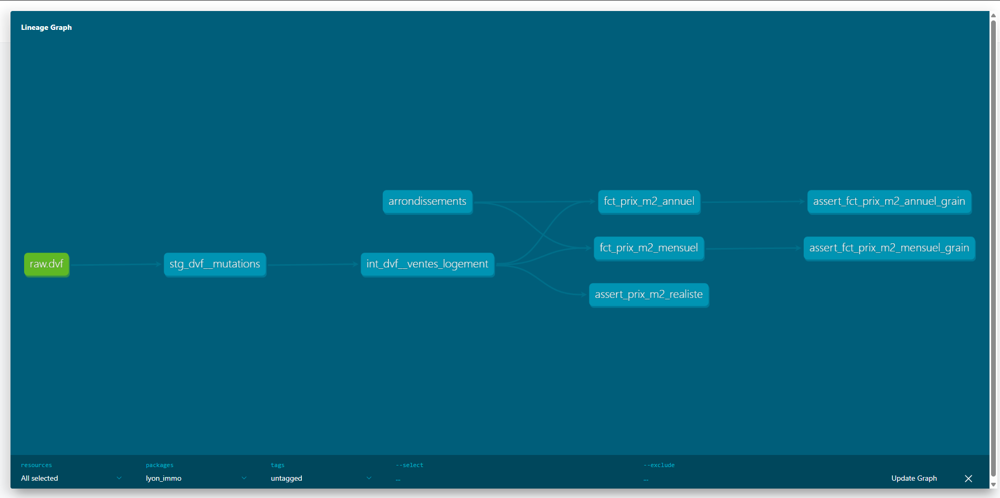

# Lyon Immo Analytics

Pipeline ELT sur les transactions immobilières lyonnaises (DVF) : Postgres, dbt, Metabase.

Every property sale in Lyon's 9 arrondissements from 2021 to 2025, modelled into a tested
price-per-m² and volume dataset, and served in a Metabase dashboard.

## Architecture

```
DVF géolocalisées (data.gouv.fr)
  → Python loader → Postgres raw.dvf (untouched, all text)
  → dbt: staging → intermediate → marts (16 tests)
  → Metabase dashboard (created by script)
```



| Layer | Model | Grain | Materialization |
|---|---|---|---|
| staging | `stg_dvf__mutations` | one raw DVF line, Lyon only, typed | view |
| intermediate | `int_dvf__ventes_logement` | one sale of a single dwelling | view |
| marts | `fct_prix_m2_mensuel` | arrondissement × month × dwelling type | table |
| marts | `fct_prix_m2_annuel` | arrondissement × year × dwelling type | table |

## Dashboard


**Key insight:** Lyon's market corrected after interest rates rose. Sales volume fell 29%
between 2021 and 2024, and the median apartment price dropped about 12% between 2022 and 2025
(5,088 → 4,471 €/m²). 2025 shows volumes recovering (+16%) without prices following. Lyon 6e
stays the most expensive arrondissement, about 22% above the city median.

## Modelling decisions

### ELT: the loader doesn't clean anything
`load/load_dvf.py` copies the files into `raw.dvf` as-is, with every column as text. All
typing and business logic lives in dbt, where it's versioned, tested and documented. The
loader only checks that every yearly file has the same header, and fails on schema drift.

### One sale is spread over several rows
DVF stores a sale (`id_mutation`) as one row per lot or parcel, with the **total** price
repeated on every row: about 2.3 rows per sale in Lyon. Averaging rows would count the same
price several times. `int_dvf__ventes_logement` collapses the data to one row per sale, and
a `unique` test on `id_mutation` proves it.

### Only sales whose price belongs to one dwelling
A price per m² is only meaningful if the price matches the surface. Of 46,347 sales:

| Rule | Sales affected | Why |
|---|---|---|
| Keep `Vente` only | — | Off-plan sales (VEFA), exchanges and auctions aren't comparable market prices |
| Count **distinct** dwellings, not rows | 249 kept | A house on two parcels appears twice; counting rows would wrongly drop it |
| Exclude sales with several dwellings | 1,384 dropped | The total price can't be split between units |
| Exclude sales including commercial premises | 293 dropped | The price includes the shop |
| Require a price and a positive surface | 14 dropped | No price per m² can be computed |
| Plausible price per m² (1,000–20,000 €) | 388 dropped (1.1%) | See below |

Outbuildings (garages, cellars, parking) and land are kept: they're part of the dwelling's price.

### Outliers
The singular test `assert_prix_m2_realiste` failed on the first run with 388 sales. Looking at
them showed they aren't market prices: on the low side, apartments sold for €1 or €500
(family transfers, or life-annuity sales where only the down payment is declared); on the
high side, 22 m² declared at €645k, where the surface doesn't cover what was sold. They're
filtered in the intermediate model. The bounds are variables in `dbt_project.yml`, shared by
the model and the test, which now guards against regressions.

### Median, not average
A few luxury or abnormal sales pull the average up. The median is what a typical buyer pays,
so it's the headline metric; the average is kept in the marts to show the gap.

### Two marts, because medians don't add up
Counts can be summed from months to years, but a yearly median **can't** be computed from
monthly medians. The yearly mart computes its medians from the individual sales instead of
letting the BI tool re-aggregate them wrongly.

### Views below, tables on top
Staging and intermediate are views: cheap, and always in sync with the layer below. Marts are
tables because Metabase queries them on every dashboard load. Metabase only reads `marts`.

### Dashboard as code
`metabase/create_dashboard.py` creates the charts and the dashboard through Metabase's API.
It's re-runnable, and the dashboard can be rebuilt from scratch on a new machine.

## Limitations

- **Houses are a thin series** in Lyon (0 to 69 sales per arrondissement per year). Counts are
  shown next to every median so they aren't over-read.
- **Surface** is `surface_reelle_bati` (built surface), not the legal Carrez surface, which is
  only filled in for some lots.
- Two genuinely identical flats sold together (same type, surface and rooms) would be counted
  as one dwelling. This is rare and accepted.
- Prices are nominal euros, not adjusted for inflation.
- DVF is a rolling window of about 5 years: re-running the download later shifts the period.

## How to run

Requirements: Docker, Python 3.11+.

```bash
docker compose up -d                       # Postgres :5432, Metabase :3000
python -m venv .venv && .venv/Scripts/activate   # macOS/Linux: source .venv/bin/activate
pip install -r requirements.txt
python load/download_dvf.py                # Rhône DVF 2021–2025 → data/
python load/load_dvf.py                    # data/*.csv.gz → raw.dvf, untouched
cd dbt && dbt seed && dbt build && cd ..   # models + tests
MB_API_KEY=mb_xxx python metabase/create_dashboard.py   # dashboard as code
```

For the last step, connect Metabase to Postgres first (host `postgres`, database `lyon_immo`,
user and password `analytics`) and create an API key in Admin → Authentication → API keys.

**Data:** [DVF géolocalisées](https://files.data.gouv.fr/geo-dvf/latest/csv/), Etalab /
DGFiP, Licence Ouverte 2.0.
