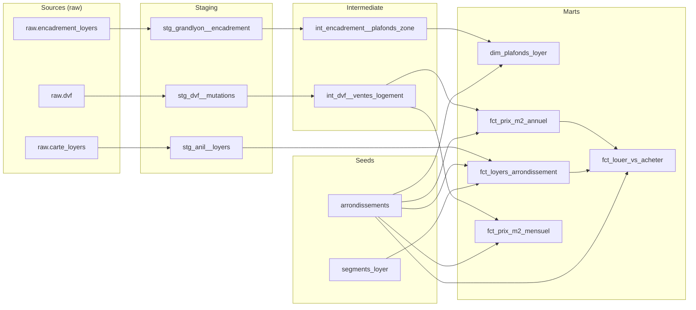
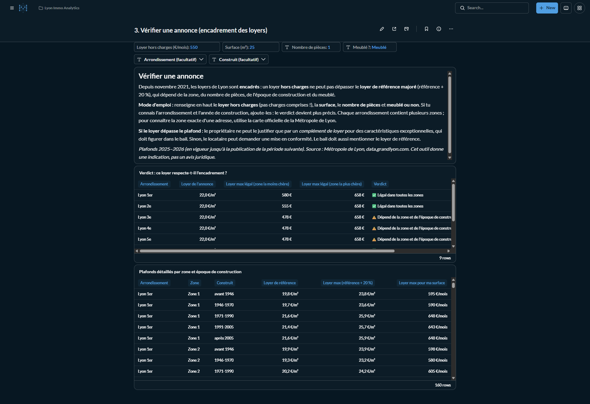

# Lyon Immo Analytics

Pipeline ELT sur l'immobilier lyonnais (ventes DVF, loyers ANIL, encadrement des loyers) :
Postgres, dbt, Metabase.

Three public sources about Lyon housing, modelled into tested marts and served in four
Metabase dashboards: the sales market, what a rent budget buys, a listing checker for Lyon's
rent control, and a buy-vs-rent comparison. I built it while looking for a flat in Lyon.

## Sources

| Source | Publisher | What it gives | Grain |
|---|---|---|---|
| [DVF géolocalisées](https://files.data.gouv.fr/geo-dvf/latest/csv/) | DGFiP / Etalab | Every property sale, 2021–2025 | one row per lot or parcel of a sale |
| [Carte des loyers](https://www.data.gouv.fr/datasets/carte-des-loyers-indicateurs-de-loyers-dannonce-par-commune-en-2025) | ANIL / Ministère du Logement | Modelled listing rent per m², charges included | commune (arrondissement in Lyon) × segment |
| [Encadrement des loyers](https://www.data.gouv.fr/datasets/encadrement-des-loyers-de-la-metropole-de-lyon-2025-2026) | Métropole de Lyon | Legal reference rents | IRIS (neighbourhood), as a JSON tree |

## Architecture

```
DVF, Carte des loyers, Encadrement des loyers
  → Python loaders → Postgres raw.* (untouched, all text)
  → dbt: staging → intermediate → marts (35 tests)
  → Metabase: 4 dashboards with filters (created by script)
```

<!-- lineage:start -->

<!-- lineage:end -->

| Layer | Model | Grain | Materialization |
|---|---|---|---|
| staging | `stg_dvf__mutations` | one raw DVF line, Lyon only, typed | view |
| staging | `stg_anil__loyers` | arrondissement × rent segment | view |
| staging | `stg_grandlyon__encadrement` | IRIS × rooms × construction period × furnished | view |
| intermediate | `int_dvf__ventes_logement` | one sale of a single dwelling | view |
| intermediate | `int_encadrement__plafonds_zone` | arrondissement × rent control zone × rooms × period × furnished | view |
| marts | `fct_prix_m2_mensuel` | arrondissement × month × dwelling type | table |
| marts | `fct_prix_m2_annuel` | arrondissement × year × dwelling type | table |
| marts | `fct_loyers_arrondissement` | arrondissement × rent segment | table |
| marts | `dim_plafonds_loyer` | arrondissement × zone × rooms × period × furnished | table |
| marts | `fct_louer_vs_acheter` | arrondissement | table |

## Dashboards



1. **Marché de la vente**: price per m² and sales volumes. Lyon's market corrected after
   interest rates rose: sales fell 29% between 2021 and 2024, and the median apartment price
   dropped about 12% between 2022 and 2025 (5,088 → 4,471 €/m²).
2. **Louer à Lyon : mon budget**: filters for a solo budget, a flatshare budget and the number
   of flatmates. With 600 €/month alone you rent 30–33 m² in any arrondissement: small-flat
   rents barely vary across Lyon (18.4–20.3 €/m²) while sale prices vary by almost 50%. A
   flatshare of two at 1,400 € gives 42–49 m² each, about 45% more space per person.
3. **Vérifier une annonce**: enter a listing's rent excluding charges, surface, rooms and
   furnished or not; it tells you whether the rent is legal under Lyon's rent control, in
   every zone, depending on the zone, or nowhere, and by how much it is over.
4. **Louer ou acheter ?**: buying an apartment costs 19 to 26 years of rent depending on the
   arrondissement. Lyon 6e is the least favourable to buy, 5e and 9e the most.

## Modelling decisions

### ELT: the loaders don't clean anything
`load/load_dvf.py` and `load/load_loyers.py` copy the files into `raw` as-is, with every column as text. All
typing and business logic lives in dbt, where it's versioned, tested and documented. The
loaders only check that every file of a table has the same header, and fail on schema drift.

### One sale is spread over several rows
DVF stores a sale (`id_mutation`) as one row per lot or parcel, with the **total** price
repeated on every row: about 2.3 rows per sale in Lyon. Averaging rows would count the same
price several times. `int_dvf__ventes_logement` collapses the data to one row per sale, and
a `unique` test on `id_mutation` proves it.

### Only sales whose price belongs to one dwelling
A price per m² is only meaningful if the price matches the surface. Of 46,347 sales:

| Rule | Sales affected | Why |
|---|---|---|
| Keep `Vente` only | — | Off-plan sales (VEFA), exchanges and auctions aren't comparable market prices |
| Count **distinct** dwellings, not rows | 249 kept | A house on two parcels appears twice; counting rows would wrongly drop it |
| Exclude sales with several dwellings | 1,384 dropped | The total price can't be split between units |
| Exclude sales including commercial premises | 293 dropped | The price includes the shop |
| Require a price and a positive surface | 14 dropped | No price per m² can be computed |
| Plausible price per m² (1,000–20,000 €) | 388 dropped (1.1%) | See below |

Outbuildings (garages, cellars, parking) and land are kept: they're part of the dwelling's price.

### Outliers
The singular test `assert_prix_m2_realiste` failed on the first run with 388 sales. Looking at
them showed they aren't market prices: on the low side, apartments sold for €1 or €500
(family transfers, or life-annuity sales where only the down payment is declared); on the
high side, 22 m² declared at €645k, where the surface doesn't cover what was sold. They're
filtered in the intermediate model. The bounds are variables in `dbt_project.yml`, shared by
the model and the test, which now guards against regressions.

### Median, not average
A few luxury or abnormal sales pull the average up. The median is what a typical buyer pays,
so it's the headline metric; the average is kept in the marts to show the gap.

### Two marts, because medians don't add up
Counts can be summed from months to years, but a yearly median **can't** be computed from
monthly medians. The yearly mart computes its medians from the individual sales instead of
letting the BI tool re-aggregate them wrongly.

### Views below, tables on top
Staging and intermediate are views: cheap, and always in sync with the layer below. Marts are
tables because Metabase queries them on every dashboard load. Metabase only reads `marts`.

### Rents: read the methodology note before charting
The ANIL rent indicators are modelled from listings, **charges included**, for **unfurnished**
flats listed in Q3 of the edition year. The ANIL guide states that editions **can't be compared
over time** (the model's geography changes every year), so the pipeline only loads the latest
edition and there is no rent trend chart. The guide's reliability bars (adjusted R² ≥ 0.5, at
least 30 listings) are a dbt test: every Lyon arrondissement clears them with thousands of
listings. Each indicator is computed for a reference surface (37 m² for 1–2 rooms, 72 m² for
3+), kept in the `segments_loyer` seed.

### Rent control: flatten a JSON tree, then prove the zones are consistent
The Métropole publishes reference rents per IRIS as a JSON tree (rooms → construction period →
furnished → reference, maximum, minimum). Staging flattens it with `jsonb_each`. The caps are
actually set per **zone**; every IRIS of a zone repeats them. The intermediate model groups by
zone *and* by the values, so the grain test fails if two IRIS of one zone ever disagree.

### Two different "rents" are never mixed
Market rents (ANIL) include charges; rent control caps exclude them. The listing checker asks
for the rent **excluding charges** and only compares it with the caps. The budget dashboard
only uses market rents.

### Buy vs rent joins the two sources
`fct_louer_vs_acheter` joins the latest DVF median apartment price with the ANIL rent on the
arrondissement code: price per m² ÷ (rent per m² × 12) gives the years of rent a purchase is
worth. The rent includes charges, so the gross yield is slightly flattering; the dashboard
says so.

### Dashboards as code
`metabase/create_dashboards.py` builds the four dashboards through Metabase's API, one file per
dashboard in `metabase/dashboards/`. Filters are declared once per dashboard; the script gives
each card a template tag for every filter its SQL uses and wires them up. It's re-runnable, so
the dashboards can be rebuilt from scratch on a new machine.

## Limitations

- **Houses are a thin series** in Lyon (0 to 69 sales per arrondissement per year). Counts are
  shown next to every median so they aren't over-read.
- **Surface** is `surface_reelle_bati` (built surface), not the legal Carrez surface, which is
  only filled in for some lots.
- Two genuinely identical flats sold together (same type, surface and rooms) would be counted
  as one dwelling. This is rare and accepted.
- Prices are nominal euros, not adjusted for inflation.
- DVF is a rolling window of about 5 years: re-running the download later shifts the period.
- Market rents are **model estimates per arrondissement**, not medians of real leases; a real
  listing can fall outside the 95% interval. They're also unfurnished: furnished flats cost
  about 13% more (from the rent control reference rents).
- The listing checker can't place an address in its rent control zone (that needs geocoding),
  so it shows the range across the arrondissement's zones; the official map gives the exact zone.

## How to run

Requirements: Docker, Python 3.11+.

```bash
docker compose up -d                       # Postgres :5432, Metabase :3000
python -m venv .venv && .venv/Scripts/activate   # macOS/Linux: source .venv/bin/activate
pip install -r requirements.txt
python load/download_dvf.py                # Rhône DVF 2021–2025 → data/
python load/download_loyers.py             # ANIL rents + rent control → data/loyers/
python load/load_dvf.py                    # → raw.dvf, untouched
python load/load_loyers.py                 # → raw.carte_loyers, raw.encadrement_loyers
cd dbt && dbt seed && dbt build && cd ..   # models + tests
python docs/generate_lineage.py            # refresh the lineage diagram in this README
MB_API_KEY=mb_xxx python metabase/create_dashboards.py   # dashboards as code
```

For the last step, connect Metabase to Postgres first (host `postgres`, database `lyon_immo`,
user and password `analytics`) and create an API key in Admin → Authentication → API keys.

**Data:** DVF géolocalisées (Etalab / DGFiP), Licence Ouverte 2.0. Estimations ANIL, à partir
des données du Groupe SeLoger et de leboncoin. Encadrement des loyers : Métropole de Lyon,
data.grandlyon.com.
